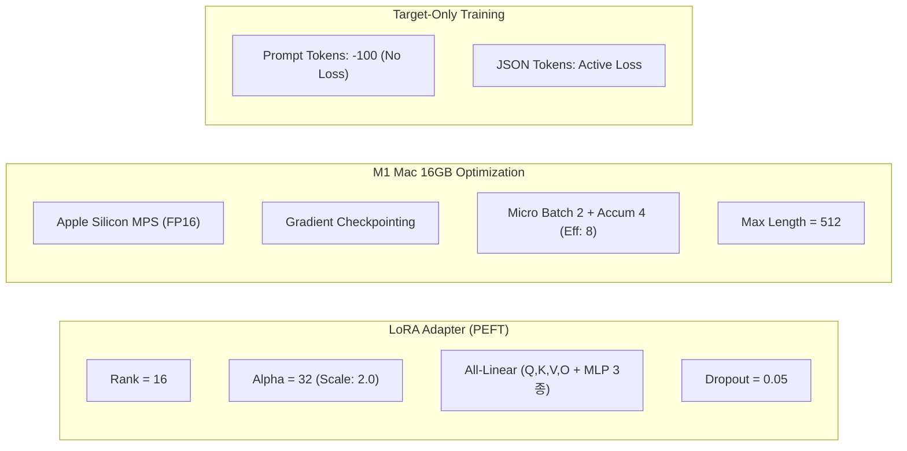

# SiteBoard 1차 파일럿 파인튜닝 하이퍼파라미터 상세 보고서

이 문서는 초기 Apple Silicon 환경 검토 당시의 하이퍼파라미터 메모입니다. 검증된 당시 실행 설정으로 간주하지 않습니다.

[보존 설정](config.json)은 이전 구조 개편에서 구성한 설정이며 당시 실행값 전체를 복원한 것으로 검증되지 않았습니다. 이 메모의 5 epoch·최대 길이 512와 보존 설정의 3 epoch·최대 길이 1024가 다릅니다. 아래 선정 근거와 성능·메모리 관련 표현은 당시의 검토 의견으로 보존하며 실험으로 검증된 근거는 확인되지 않았습니다. 현재 보유 자료와 재현 한계는 [파일럿 안내](README.md)를 따릅니다.

---

## 1. 하이퍼파라미터 총괄 요약표

| 구분 | 하이퍼파라미터명 | 설정값 | 무엇을 하는 파라미터인가? | 왜 이 값을 선정했는가? (선정 근거) |
| :--- | :--- | :---: | :--- | :--- |
| **기본 모델** | `model_name_or_path` | `Qwen/Qwen2.5-1.5B-Instruct` | 사전 학습된 기본 언어 모델 | 16GB M1 Mac에서 고속 학습 가능하며 한국어 및 구조화된 JSON 추론 능력이 뛰어남 |
| **LoRA** | `lora_r` (Rank) | `16` | 저차원 분해 행렬의 랭크(Rank) 차원 크기 | 8은 복합 공종 지식 주입에 다소 협소할 수 있고, 32는 300건에서 과적합 우려가 있어 **표현력과 일반화의 최적 균형점**인 16 선택 |
| **LoRA** | `lora_alpha` | `32` | LoRA 가중치 업데이트의 스케일링 계수 ($\Delta W \times \frac{\alpha}{r}$) | 관례적으로 $2 \times r$ (스케일링 배율 2.0)을 적용하여 어댑터의 초기 학습 신호를 모델에 안정적으로 전파 |
| **LoRA** | `lora_dropout` | `0.05` | LoRA 어댑터 내부 드롭아웃 확률 | 소규모 데이터셋(300건)에서 특정 단어나 표현에 과도하게 고착(과적합)되는 것을 방지하는 정규화 효과 |
| **LoRA** | `target_modules` | `["q_proj", "k_proj", "v_proj", "o_proj", "gate_proj", "up_proj", "down_proj"]` | LoRA 어댑터를 부착할 선형 레이어 목록 | Attention(`q,k,v,o`)뿐만 아니라 FFN/MLP(`gate,up,down`)까지 포함하여 **도메인 지식(공종명/규격) 저장 능력 극대화** |
| **학습 스케줄** | `num_train_epochs` | `5` | 전체 데이터셋을 반복 학습하는 횟수 | 300건 기준 약 188스텝을 확보하여, 3 Epoch(112스텝)의 과소적합을 방지하고 문법/공종명을 확실히 수렴시킴 |
| **배치 설정** | `batch_size` | `2` | 디바이스(MPS)당 미니배치 크기 | M1 16GB 메모리에서 OOM(Out-Of-Memory)을 원천 차단하는 가장 안전한 크기 |
| **배치 설정** | `gradient_accumulation_steps` | `4` | 역전파 시 그래디언트를 누적하는 스텝 수 | `2 (배치) × 4 (누적) = 8`의 실효 배치(Effective Batch) 크기를 형성하여 안정적인 파라미터 업데이트 보장 |
| **최적화** | `learning_rate` | `2e-4` (`0.0002`) | AdamW 옵티마이저의 초기 학습률 | LoRA 파인튜닝의 사실상 표준 학습률 ($1\text{e-}4 \sim 3\text{e-}4$)로, 소수 파라미터의 빠른 수렴 지원 |
| **최적화** | `lr_scheduler_type` | `cosine` | 시간에 따른 학습률 감쇠 스케줄러 | 초기 웜업 후 매끄러운 곡선으로 학습률을 줄여 후반부 가중치 진동을 억제하고 정밀한 국소 최적점 도달 |
| **최적화** | `warmup_steps` | `10` | 0에서 목표 학습률까지 서서히 증가시키는 스텝 수 | 총 188스텝 중 초기 약 5.3% 구간 동안 가중치 급변(Cold Start 충격)을 방지하여 학습 안정성 확보 |
| **최적화** | `optim` | `adamw_torch` | 옵티마이저 알고리즘 | PyTorch 내장 옵티마이저로 Apple Silicon MPS 환경에서 100% 네이티브 호환 |
| **시퀀스 길이** | `max_seq_len` | `512` | 최대 입력 토큰 길이 제한 | 본 데이터의 평균 토큰 길이는 120~200 토큰 내외이므로, 512면 잘림(Truncation) 없이 메모리 낭비 제로 |
| **하드웨어 최적화** | `torch_dtype` | `torch.float16` | 모델 가중치 및 연산 정밀도 | M1 GPU(MPS)의 반정밀도 가속을 사용하여 FP32 대비 메모리 점유율을 50% 절감하고 속도 대폭 향상 |
| **하드웨어 최적화** | `gradient_checkpointing` | `True` | 순전파 활성화 텐서를 저장하지 않고 역전파 시 재계산 | 16GB RAM 환경에서 활성화 메모리를 60% 이상 절감하여 OOM 완전 차단 |
| **데이터 처리** | `Prompt Loss Masking` | `-100` | System/User 프롬프트 구간 손실 마스킹 | 질문(프롬프트) 복제 학습을 차단하고, **오직 목표 정답(JSON 배열) 생성에만 손실을 역전파** |
| **데이터 처리** | `pad_to_multiple_of` | `8` | 텐서 패딩 길이를 특정 배수로 맞춤 | GPU/NPU 하드웨어 텐서 코어의 메모리 정렬(Memory Alignment) 최적화 |

---

## 2. 세부 파라미터별 심층 분석 및 설계 근거



---

### 2.1 LoRA 파라미터 심층 분석

#### 1) Rank (`r = 16`) & Alpha (`alpha = 32`)
* **역할**: 기존 선형 레이어 가중치 $W \in \mathbb{R}^{d \times k}$에 저랭크 행렬곱 $\Delta W = B \cdot A$ ($B \in \mathbb{R}^{d \times r}, A \in \mathbb{R}^{r \times k}$)를 부착합니다.
* **선정 근거**:
  * $r=8$: 단순한 텍스트 분류에는 충분하지만, 본 태스크는 **복합 공종(최대 6개) 분해 및 규격 매핑**이라는 복잡한 규칙 추론이 필요하여 표현력이 다소 제한적입니다.
  * $r=16$: 300건의 작은 데이터셋에서도 과적합을 일으키지 않으면서 구조적 JSON 문법과 건설 도메인 관계를 충분히 학습할 수 있는 **골든 밸런스**입니다.
  * $\alpha = 32$: 스케일링 팩터 $\frac{\alpha}{r} = \frac{32}{16} = 2.0$을 적용하여, 초기 파인튜닝 시 LoRA 가중치 변화량이 기존 사전학습 가중치에 묻히지 않고 명확하게 반영되도록 유도합니다.

#### 2) All-Linear Target Modules
* **대상**: `q_proj`, `k_proj`, `v_proj`, `o_proj`, `gate_proj`, `up_proj`, `down_proj` (총 7개 모듈)
* **선정 근거**:
  * 초기 LoRA 연구는 Attention(`q, v`)만 튜닝했으나, 최근 다수의 연구(Q-LoRA 등)에서 **MLP 계층(`gate, up, down`)에 실제 도메인 지식과 사실 정보(Factual Knowledge)가 저장**된다는 점이 입증되었습니다.
  * 본 과제는 `금속관벽체`, `PVC입상`, `차열재마감` 등의 고유 도메인 엔티티와 수치 규칙을 학습해야 하므로 전체 선형 레이어를 모두 타겟팅했습니다.

#### 3) LoRA Dropout (`0.05`)
* **선정 근거**: 300개의 제한된 데이터셋에서 특정 사진 번호나 특정 문장 구조에 가중치가 과도하게 피팅되는 현상을 억제하기 위해 가벼운 $5\%$의 정규화 드롭아웃을 적용했습니다.

---

### 2.2 학습 스케줄링 및 최적화 분석

#### 1) 학습 에폭 및 스텝 수 계산
* **수식**:
  $$\text{총 스텝 수} = \frac{\text{샘플 수 (300)}}{\text{실효 배치 크기 (8)}} \times \text{Epochs (5)} = 37.5 \times 5 \approx 188\text{ Steps}$$
* **선정 근거**:
  * 3 Epoch(약 112스텝)는 새로운 도메인 JSON 스키마를 고정하기에 스텝이 다소 부족하여 Underfitting 가능성이 존재합니다.
  * **5 Epoch(약 188스텝)**은 모델이 도메인 공종명과 JSON 형식을 흔들림 없이 각인하면서도, 300건 데이터에 암기(Memorization)되지 않는 최적의 수렴 구간입니다.

#### 2) 학습률 (`2e-4`) 및 코사인 스케줄러 + 10스텝 웜업
* **선정 근거**:
  * Full Fine-Tuning($1\text{e-}5 \sim 5\text{e-}5$)과 달리, LoRA는 작은 어댑터 행렬만 학습하므로 통상적으로 **10배 이상 높은 학습률($2\text{e-}4$)**을 적용해야 원활하게 수렴합니다.
  * 초기 10스텝 동안 Learning Rate를 0에서 $2\text{e-}4$까지 점진적으로 올려 초기 그래디언트 폭발(Gradient Explosion)을 방지하고, 이후 Cosine Annealing으로 점진적 감쇠를 거쳐 정밀한 전역 최적점에 안착합니다.

---

### 2.3 M1 Mac 16GB 하드웨어 최적화 분석

#### 1) Apple Silicon MPS + `torch.float16`
* M1 통합 메모리(Unified Memory) 환경에서 `float16`을 사용하여 모델 파라미터와 옵티마이저 상태 메모리를 약 **3.2GB 내외**로 억제합니다.

#### 2) Micro Batch 2 + Gradient Accumulation 4
* 1회 포워드/백워드 연산 시 메모리 점유를 최소화하기 위해 디바이스 배치를 2로 제한하고, 4회 누적 후 옵티마이저를 스텝(`step()`)하여 실질적인 배치 크기를 8로 유지합니다.

#### 3) Gradient Checkpointing
* 역전파를 위한 모든 중간 활성화 텐서를 메모리에 유지하지 않고, 백워드 패스 시 즉석에서 재계산하여 활성화 메모리를 획기적으로 줄입니다.

---

### 2.4 데이터 손실 마스킹 전략 (Prompt Loss Masking)

```text
[System Prompt + User Prompt] -> 토큰 ID 레이블: -100 (PyTorch CrossEntropyLoss 계산에서 제외)
[Assistant Target JSON Output] -> 토큰 ID 레이블: 실제 토큰 ID (Loss 계산 및 역전파 수행)
```

* **선정 근거**:
  * 프롬프트를 마스킹하지 않으면 모델이 "현장: GJ\n보드판 텍스트: ..."라는 입력 패턴 자체를 재생성하는 데 손실 값의 절반 이상을 소모하게 됩니다.
  * 프롬프트 구간을 `-100`으로 처리함으로써, **모델의 모든 학습 역량이 `[{"workType": ..., "spec": ..., "quantity": ...}]`를 정확히 맞추는 데 100% 집중**되도록 보장합니다.
