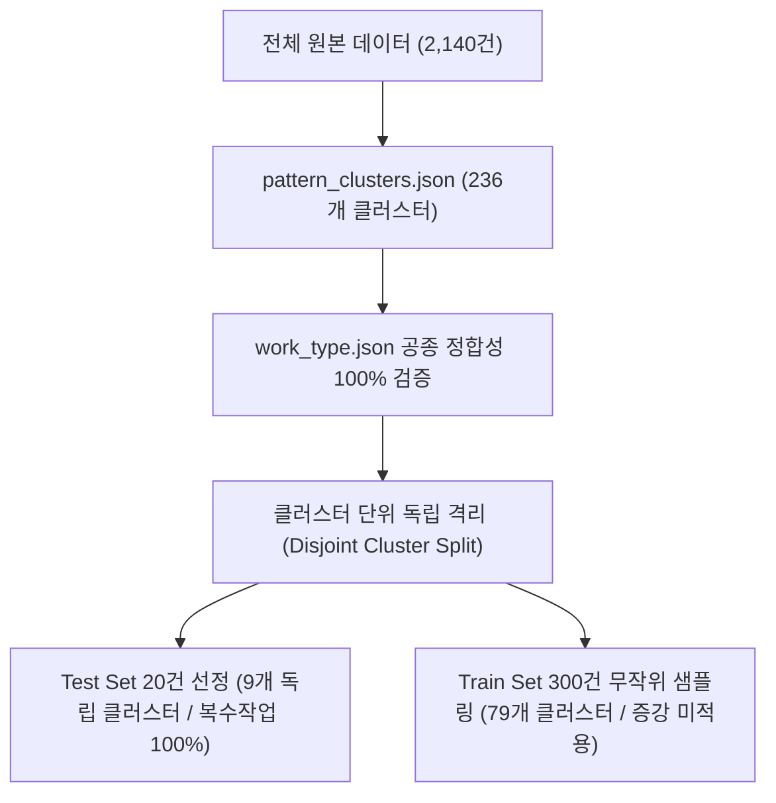

# 파일럿 분할 상세 기록

초기 파일럿 문서의 분할 방법과 통계를 보존했습니다. 아래 클러스터는 당시 2,140건 데이터 기준이며, 현재 정제 데이터의 클러스터 ID와 혼용하지 않습니다. 현재 보유 자료와 재현 한계는 [파일럿 실험](README.md)을 따릅니다. 정확한 당시 코드가 없어 노트북 실행은 보류했습니다.

## 2. 데이터 분할 방법론 (Split Methodology)

1. **클러스터 단위 완전 격리 (Disjoint Pattern Clusters)**:
   * 텍스트 구조 시그니처 기반 236개 클러스터 중 테스트셋으로 선택된 9개 클러스터의 모든 샘플을 학습 후보군에서 완전 배제하여 **학습/테스트 간 패턴 누출(Data Leakage)을 0건으로 보장**합니다.
2. **복합 작업(Multi-label) 타겟팅**:
   * 테스트셋은 복합 공종 분해 능력을 집중 평가하기 위해 **복수 작업(`len(y) >= 2`) 100%(20건 전수)**로 구성되었습니다.
3. **무증강 순수 원본 학습 (Zero Augmentation)**:
   * 인위적 텍스트 변형/치환 없이 현장 원본 텍스트 300건만으로 LoRA 적응 신호를 검증합니다.

---

## 3. 세부 데이터 분포 통계

### 3.1 테스트셋 (Test Set - 20건) 클러스터 및 패턴 전수 명세

테스트셋은 **9개 독립 클러스터**에 분산되어 있으며, 전수 20건이 복수 공종(2개~6개)으로 이루어져 있습니다.

| 클러스터 ID | 샘플 수 | 대표 시그니처 (Pattern Skeleton) | 주요 현장 | 보드판 텍스트(`x`) 예시 | 정답 레이블(`y`) 구성 예시 |
| :---: | :---: | :--- | :---: | :--- | :--- |
| **#51** | 7건 | `입상 <NUM> 보<NUM>×<NUM>.<NUM>×<NUM>` | GJ | `13번 입상 50 보150×2.100×2` | 금속관입상(100):2, 금속관입상(150):2, 금속관입상(50):1 |
| **#61** | 5건 | `pvc <NUM>.<NUM>.<NUM> 양면` | SB | `19. pvc 100.125.150 양면` | PVC벽체(100):1, PVC벽체(125):1, PVC벽체(150):1 |
| **#126** | 2건 | `벽체 보D<NUM>*<CNT>.<NUM>.<NUM> pvc<NUM>.<NUM>.<NUM> 단면` | GJ | `12- 벽체 보D125*2.100.50 pvc200.150.100 단면` | 금속관벽체 3종(125, 100, 50) + PVC벽체 3종(200, 150, 100) |
| **#214** | 1건 | `<NUM> - D 벽체 <NUM>*<CNT> <NUM>. (시공후)양면` | JW | `1 - D 벽체 50*3 80. (시공후)양면` | 금속관벽체(50):3, 금속관벽체(80):1 |
| **#205** | 1건 | `D 입상 무 <NUM>*<CNT> <NUM> <NUM> pvc <NUM>` | GJ | `5-D 입상 무 100*3 125 60 pvc 100` | 금속관입상(100):3, 금속관입상(125):1, 금속관입상(65):1, PVC입상(100):1 |
| **#223** | 1건 | `pvc <NUM>*<CNT> 무D <NUM>*<CNT>.<NUM>*<CNT> 양면` | SB | `15.pvc 100*3 무D 50*6.30*3 양면` | PVC벽체(100):3, 금속관벽체(50):6, 금속관벽체(32):3 |
| **#206** | 1건 | `입상 무 <DIM> 차열마감<NUM>번 무<NUM>*<CNT> <NUM>*<CNT> <NUM>*<CNT>` | GJ | `7번 입상 무 400*200 차열마감1번 무100*4 80*4 20*2` | 무보온덕트입상(400*200):0.5, 무보온입상차열재마감:0.5, 금속관입상 3종 |
| **#196** | 1건 | `AD 벽체 보<NUM>,무<NUM> 양면` | GJ | `5-AD 벽체 보150,무150 양면` | 금속관벽체(150):1, 금속관벽체(150):1 |
| **#207** | 1건 | `입상 무 <NUM>*<CNT> <NUM>*<CNT> pvc<NUM>*<CNT> <NUM>*<CNT>` | GJ | `8번 입상 무 80*4 100*5 pvc100*2 32*2` | 금속관입상(80):4, 금속관입상(100):5, PVC입상(100):2, PVC입상(30):2 |

---

### 3.2 학습셋 (Train Set - 300건) 상위 15대 클러스터 분포

학습셋은 **총 79개 고유 클러스터**에 균형 있게 분포되어 있습니다. (테스트셋 9개 클러스터와 교차 0건)

| 클러스터 ID | 샘플 수 | 점유율 (%) | 대표 시그니처 (Pattern Skeleton) |
| :---: | :---: | :---: | :--- |
| **#0** | 63건 | 21.0% | `벽체 보 <DIM> 차열마감<NUM>번 단면` |
| **#2** | 21건 | 7.0% | `<NUM> 보덕트벽체 <DIM> 차열=<NUM>번 단면` |
| **#1** | 18건 | 6.0% | `벽체 보 <NUM> 단면` |
| **#3** | 14건 | 4.7% | `무D <NUM> 양면` |
| **#6** | 13건 | 4.3% | `벽체보<NUM>×<NUM> 단면` |
| **#11** | 13건 | 4.3% | `보덕트 벽체.<DIM>차열<NUM>벌 (후) 단면` |
| **#5** | 12건 | 4.0% | `pvc <NUM>*<CNT> 양면` |
| **#4** | 10건 | 3.3% | `벽체 보 <NUM>*<CNT> 양면` |
| **#7** | 8건 | 2.7% | `pvc <NUM> 양면` |
| **#10** | 7건 | 2.3% | `벽체보<NUM> 양면` |
| **#9** | 7건 | 2.3% | `실리콘마감 <NUM>*<CNT>.<NUM> 양면` |
| **#8** | 7건 | 2.3% | `보덕트 <DIM> 차열마김<NUM>번 양면` |
| **#32** | 6건 | 2.0% | `보덕트 <DIM>.<DIM> 차열마감<NUM>번 양면` |
| **#12** | 5건 | 1.7% | `.벽체.덕트.<DIM>차열<NUM>번.단면` |
| **#19** | 4건 | 1.3% | `벽체 보 <NUM>*<CNT> <NUM> 단면` |
| **기타 (64개 클러스터)** | 92건 | 30.7% | 소수/희소 시그니처 클러스터군 (각 1~3건) |

---

### 3.3 현장(Site) 및 복합 레이블(Multi-label) 분포 비교

#### 현장별 분포 (Site Distribution)
* **Train Set (9개 현장 전수 포함)**: GJ(118건, 39.3%), SB(85건, 28.3%), DG2(27건, 9.0%), JW(19건, 6.3%), DG1(19건, 6.3%), DG3(18건, 6.0%), HG(6건, 2.0%), DG4(4건, 1.3%), BS(4건, 1.3%)
* **Test Set (3개 현장)**: GJ(13건, 65.0%), SB(6건, 30.0%), JW(1건, 5.0%)

#### 레이블 개수별 분포 (Label Count Distribution)

| 레이블 개수 (`len(y)`) | Train Set (300건) | Test Set (20건) | 설명 |
| :---: | :---: | :---: | :--- |
| **1개 (단일 작업)** | 117건 (39.0%) | 0건 (0.0%) | 단일 공종/단일 규격 |
| **2개 (복수 작업)** | 144건 (48.0%) | 6건 (30.0%) | 2개 공종 또는 복수 규격 |
| **3개 (복합 작업)** | 16건 (5.3%) | 9건 (45.0%) | 3개 규격/공종 병기 |
| **4개 (복합 작업)** | 19건 (6.3%) | 3건 (15.0%) | 4개 복합 공종 |
| **5개 (고난도 복합)** | 0건 (0.0%) | 1건 (5.0%) | 덕트+차열재+배관 복합 |
| **6개 (초고난도 복합)** | 3건 (1.0%) | 1건 (5.0%) | 금속관 3종 + PVC 3종 |
| **7개 (최대 복합)** | 1건 (0.3%) | 0건 (0.0%) | 다중 배관 집합 |
| **합계** | **300건 (복수 61.0%)** | **20건 (복수 100.0%)** | - |

---
